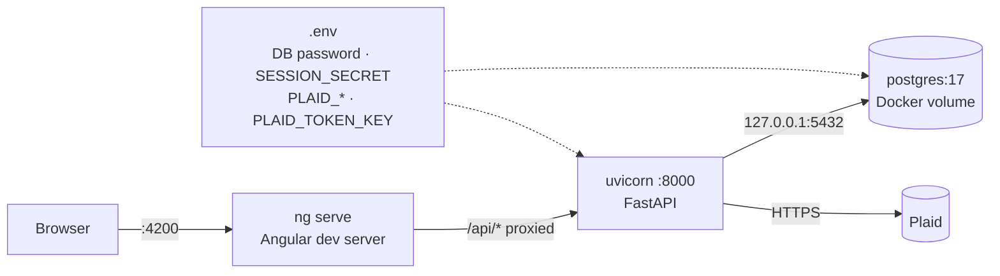
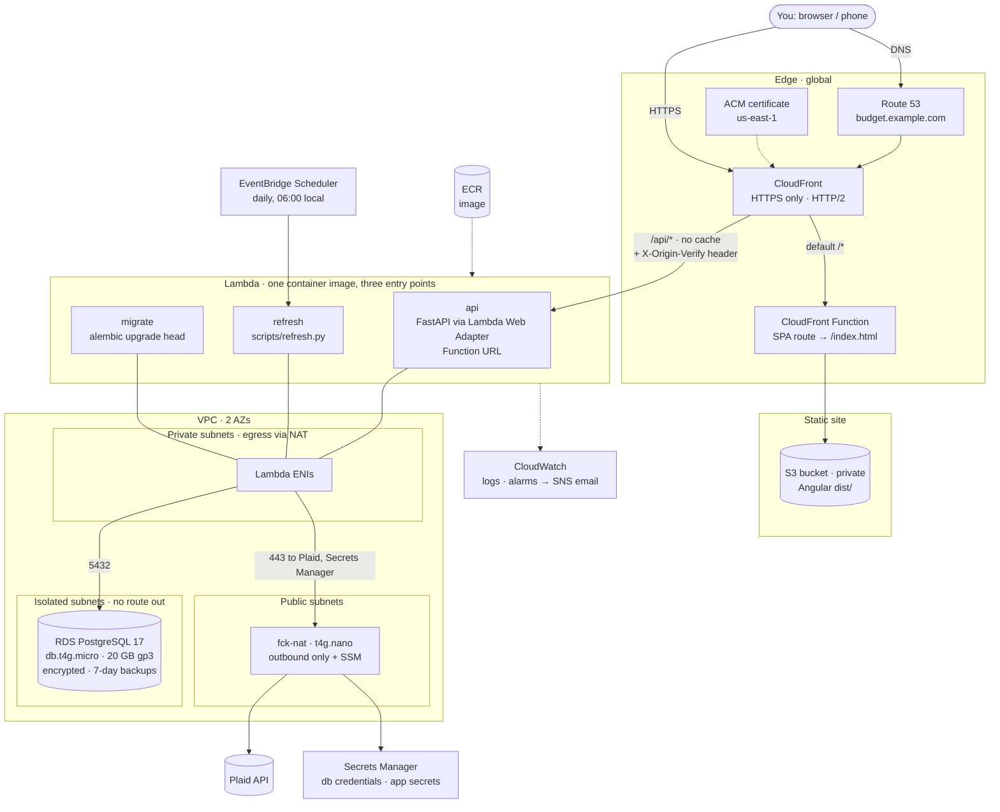
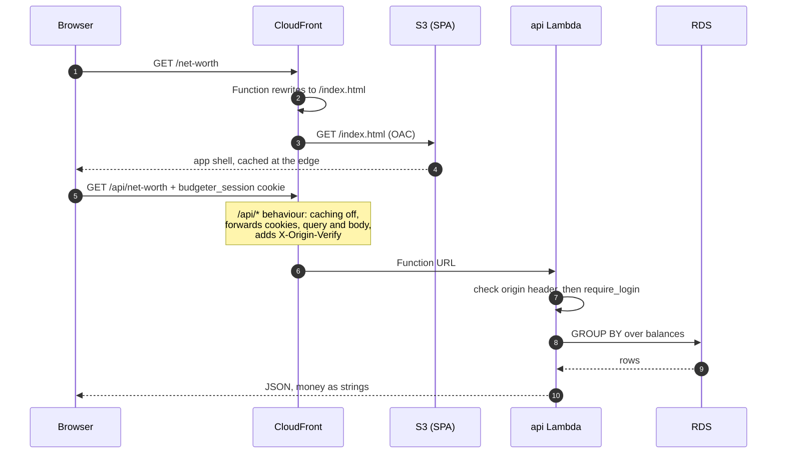
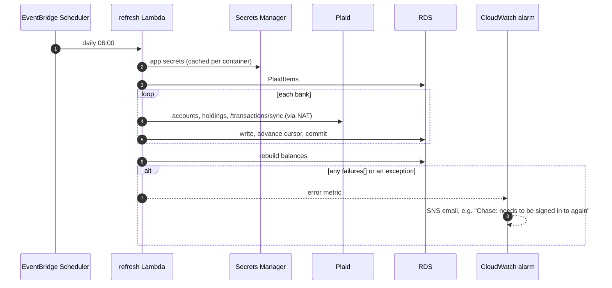
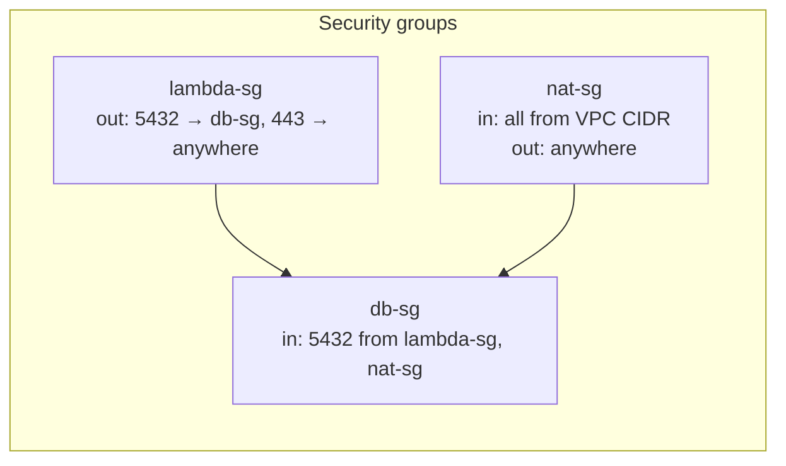
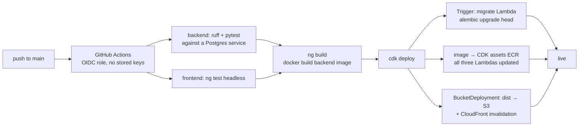
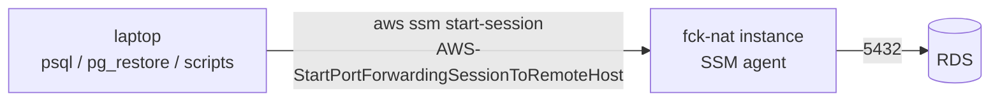
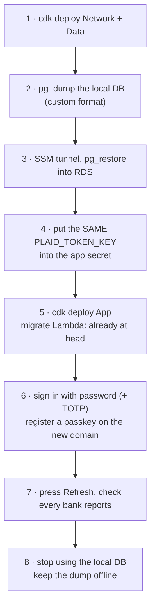

# Architecture: today, and on AWS

**Status:** proposal. `infra/` is still the empty `cdk init` stack. Nothing
here is deployed yet.

1. [Today: one laptop](#1-today-one-laptop)
2. [What shapes the AWS design](#2-what-shapes-the-aws-design)
3. [Proposed AWS architecture](#3-proposed-aws-architecture)
4. [Request paths](#4-request-paths)
5. [The daily refresh, without a browser](#5-the-daily-refresh-without-a-browser)
6. [Network and secrets](#6-network-and-secrets)
7. [Deploying](#7-deploying)
8. [Getting at the database](#8-getting-at-the-database)
9. [Cost](#9-cost)
10. [Code changes before the first deploy](#10-code-changes-before-the-first-deploy)
11. [Moving the data over](#11-moving-the-data-over)
12. [Alternatives considered](#12-alternatives-considered)

---

## 1. Today: one laptop



The browser only ever talks to `/api` on its own origin, and the dev proxy
forwards it to the backend. The AWS design keeps that shape: CloudFront plays
the proxy's part, so the cookie, CORS and passkey setup stay simple.

---

## 2. What shapes the AWS design

| Fact about this app | What it means for the design |
|---|---|
| One user, a few requests a day | Pay per request, not per hour. Lambda, not an always-on server. |
| Postgres via SQLAlchemy and Alembic, with `Decimal` everywhere | Keep real Postgres. RDS, not DynamoDB or the Aurora Data API. |
| The backend must call Plaid on the internet | Lambda in the VPC needs outbound internet. A NAT instance at ~$3/mo, not a NAT Gateway at ~$33/mo. |
| `PLAID_TOKEN_KEY` and the Plaid tokens can't be replaced | Secrets Manager, RDS backups, deletion protection, and an off-AWS copy of the key. |
| Same-origin `/api` and a SameSite cookie | One CloudFront distribution serves both the SPA and `/api/*`. |
| Passkeys are bound to a hostname | Settle on a real domain before registering passkeys. |
| The daily refresh is started by the browser today | Move it to a schedule, so the ledger fills even on days the app isn't opened. |
| It leaves loopback | Turn on TLS-only cookies, and `REQUIRE_TOTP` or a passkey. The README already calls for this. |

---

## 3. Proposed AWS architecture

Single region: **us-east-1**, which is where CloudFront's ACM certificate has
to live anyway. The VPC spans two AZs because RDS requires it; the database
itself runs in one.



| Piece | Choice | Why |
|---|---|---|
| Frontend | S3 + CloudFront with Origin Access Control | Private bucket, served only through CloudFront. |
| SPA routing | A CloudFront Function on the default behaviour that rewrites extensionless paths to `/index.html` | A distribution-wide 403/404 → `index.html` error page would also rewrite the API's real 404s. |
| API | Lambda container image running uvicorn behind the **Lambda Web Adapter** | The FastAPI app runs unchanged, with no Mangum handler, and the same image runs locally. |
| API ingress | Lambda Function URL as the CloudFront origin | No API Gateway 30s cap or per-request cost. CloudFront adds a secret header, and the app refuses requests without it. |
| Database | RDS Postgres 17, `db.t4g.micro`, single-AZ | Same engine and version as Docker. About $14/mo. |
| Outbound internet | fck-nat on a `t4g.nano` | About a fifth of a NAT Gateway's cost. It doubles as the SSM jump host for `psql`. |
| Secrets | Secrets Manager: one RDS-managed secret, one app secret | Read once at cold start. Never in Lambda env vars in plaintext. |
| Schedule | EventBridge Scheduler → the `refresh` Lambda | Fills the ledger without anyone opening the app. |
| Migrations | `migrate` Lambda run by a CDK `Trigger` on every deploy | The schema is always at head before new code serves traffic. |

---

## 4. Request paths



The cookie never crosses origins, so `SameSite=lax` and an HTTP-only cookie
work exactly as they do locally. CORS is only needed for `localhost` dev.

---

## 5. The daily refresh, without a browser

Today `sync.ts` refreshes the first time the app is opened each day. On AWS a
schedule does it, and the header button stays for refreshing on demand.



> **Measure this before relying on the button.** CloudFront waits at most 60s
> for an origin; a raised quota extends that. If a full refresh of every bank
> takes longer than that, the **Refresh** button needs to become start-then-poll.
> The scheduled run isn't affected: Lambda allows 15 minutes.

---

## 6. Network and secrets



| Secret | Where | Rotation |
|---|---|---|
| DB master credentials | RDS-managed secret | Can rotate. The app reads it at cold start. |
| `SESSION_SECRET` | app secret (JSON) | Can rotate. Rotating only signs you out. |
| `PLAID_CLIENT_ID`, `PLAID_SECRET` | app secret | Rotate in the Plaid dashboard, then update the secret. |
| `PLAID_TOKEN_KEY` | app secret, **plus an offline copy** | **Never.** Changing it orphans every linked bank. |

- Every Lambda's IAM role gets `secretsmanager:GetSecretValue` on those two ARNs and nothing else.
- RDS: storage encrypted, deletion protection on, `RemovalPolicy.SNAPSHOT`, automated backups kept 7 days.
- No public IP anywhere except the NAT instance, and it only accepts traffic from inside the VPC.
- Optional: AWS WAF with a rate-based rule on `/api/auth/*`, about $8/mo. The app already locks the account after 8 failed logins.

---

## 7. Deploying



The CDK app grows from one stack to three. That way the data survives
tearing down everything else:

| Stack | Holds | Torn down how often |
|---|---|---|
| `Network` | VPC, subnets, fck-nat, security groups | never |
| `Data` | RDS, secrets, backups | never; deletion protection is on |
| `App` | Lambdas, scheduler, S3, CloudFront, DNS records, alarms | freely |

---

## 8. Getting at the database

RDS sits in isolated subnets with no public endpoint. Use SSM port forwarding
through the NAT instance: no SSH keys and no open ports.



```sh
aws ssm start-session --target <nat-instance-id> \
  --document-name AWS-StartPortForwardingSessionToRemoteHost \
  --parameters host=<rds-endpoint>,portNumber=5432,localPortNumber=15432
psql "postgresql://budgeter@localhost:15432/budgeter"
```

The same tunnel is how `scripts/extract_plaid_items.py` and
`restore_plaid_items.py` reach production.

---

## 9. Cost

Rough on-demand prices for us-east-1, before any free tier.

| Item | Per month |
|---|---|
| RDS `db.t4g.micro` single-AZ + 20 GB gp3 | ~$14 |
| fck-nat `t4g.nano` + its public IPv4 | ~$7 |
| Lambda (a few hundred invocations) | ~$0 |
| CloudFront + S3 | < $1 |
| Secrets Manager (2 secrets) | $0.80 |
| Route 53 hosted zone | $0.50 (plus ~$14/yr for the domain) |
| CloudWatch logs + alarms | < $1 |
| **Total** | **~$23** |

Set an AWS Budgets alert at $30.

---

## 10. Code changes before the first deploy

| Change | Where | Why |
|---|---|---|
| `session_https_only` setting, true in prod | `main.py`, `config.py` | It's hard-coded `False` today. On HTTPS the cookie must be `Secure`. |
| Read secrets from Secrets Manager when `APP_SECRET_ARN` is set | `config.py` | Keeps secrets out of Lambda env vars. `.env` still works locally. |
| Build `database_url` from the RDS secret | `config.py` | The RDS-managed secret is JSON: host, port, username, password. |
| Small pool: `pool_size=1, max_overflow=0` on Lambda | `db.py` | Each Lambda container holds at most one connection, so a t4g.micro's limit is never near. |
| Reject requests missing `X-Origin-Verify` | `main.py` middleware | Only CloudFront can reach the Function URL. |
| `webauthn_rp_id` / `webauthn_origins` = the domain | env | Passkeys registered on `localhost` won't work there. Register new ones after go-live. |
| `cors_origins` | env | Prod is same-origin. Leave it empty or set it to the domain. |
| `REQUIRE_TOTP=true` or a passkey registered on day one | env | The README's own condition for leaving loopback. |
| `Dockerfile` for the backend + Lambda Web Adapter layer | `backend/` | One image, three commands: api, refresh, migrate. |
| `refresh` entry point that exits non-zero on `failures` | `scripts/refresh.py` | So the alarm fires when a bank needs signing in again. |
| `sync.ts` daily auto-refresh | frontend | Can stay as a backstop, or go once the schedule is proven. |
| Plaid **production** keys, and a `redirect_uri` if an OAuth bank asks for one | Plaid dashboard, `link-token` | Only needed for banks that redirect away during Link. |

---

## 11. Moving the data over

The ledger can't be rebuilt from Plaid: cursors, hand edits, budgets, goals,
pay stubs and archive balances live only in this database. Restore it rather
than re-linking.



If step 4 uses a different key, every stored access token is unreadable and
every bank has to be linked again. Production Plaid items are limited per
account.

---

## 12. Alternatives considered

| Option | Per month | Why not, for now |
|---|---|---|
| **Lightsail / one EC2 box** running `docker compose` + Caddy | ~$7–12 | Cheapest, but you then own the OS patches, TLS renewals, backups and disk. |
| **ECS Fargate + ALB** | ~$45+ | The ALB alone is ~$16, for a server that sits idle 99.9% of the time. |
| **NAT Gateway** instead of fck-nat | +$33 | Managed and highly available, but that's overkill for one user. |
| **API Gateway HTTP API** in front of Lambda | ~$0 | Hard 30s integration timeout, too tight for Refresh. The Function URL has none. |
| **Aurora Serverless v2** (scales to 0) | ~$0–15 | Cold resume is about 15s on the first request of the day, and it costs more under steady use. |
| **Lambda outside the VPC** + public RDS | −$7 | Puts the database on the internet to save the NAT. No. |
