# How budgeter works

What the app includes as of 2026-11-02, and the rules each figure on screen
rests on. Every diagram here is drawn from the code; the module that owns a
rule is named beside it, so a diagram that drifts can be checked.

1. [What's in the app](#1-whats-in-the-app)
2. [The data](#2-the-data)
3. [Refresh: getting the banks' data in](#3-refresh-getting-the-banks-data-in)
4. [Filing a transaction](#4-filing-a-transaction)
5. [The month](#5-the-month)
6. [Budgets](#6-budgets)
7. [Net worth over time](#7-net-worth-over-time)
8. [Where you stand: the Overview](#8-where-you-stand-the-overview)
9. [Goals](#9-goals)
10. [Signing in](#10-signing-in)

---

## 1. What's in the app

Seven screens, one API under `/api`, one Postgres database. Plaid is the only
outside service.

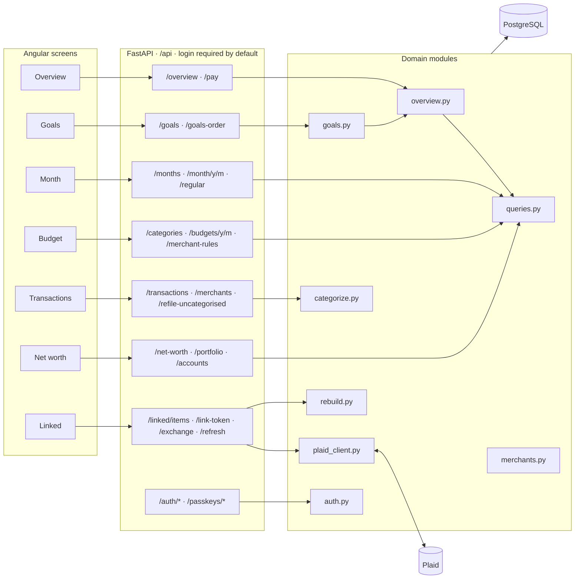

| Screen | The question it answers |
|---|---|
| **Overview** | Where do I stand today, by kind of money, and how much of what I earn do I keep? |
| **Goals** | What am I saving for, how much of it is already covered, and when will each goal be reached? |
| **Month** | Where did the money go, against the budget, against last month, and what regular charges are still to come? |
| **Budget** | What should each category cost? Set once, carried forward. Also where categories are managed. |
| **Transactions** | The ledger, with category, merchant and notes editable per row. |
| **Net worth** | What I own and owe and how that has moved, plus holdings. |
| **Linked** | Every bank and account, and whether each one is still reporting. |

### Rules that hold everywhere

- **Nothing that can be derived is stored.** Spending, net worth, budget vs actual, goals and regular charges are all computed when you ask.
- **Money is a decimal string on the wire.** Sums are done in Postgres or in Python `Decimal`. The browser adds money only in whole-cent `bigint` (`money.ts`).
- **Only `SPENDING` counts as spent.** A card payment is a `TRANSFER`, so it never counts as a purchase.
- **Liabilities are stored negative.** That way net worth is a plain sum.

---

## 2. The data

Seventeen tables. The banks fill `accounts`, `balances`, `transactions`,
`holdings`, `securities` and `contributions`. You fill `budgets`, `goals`,
`pay_stubs`, `merchant_rules` and the category map.

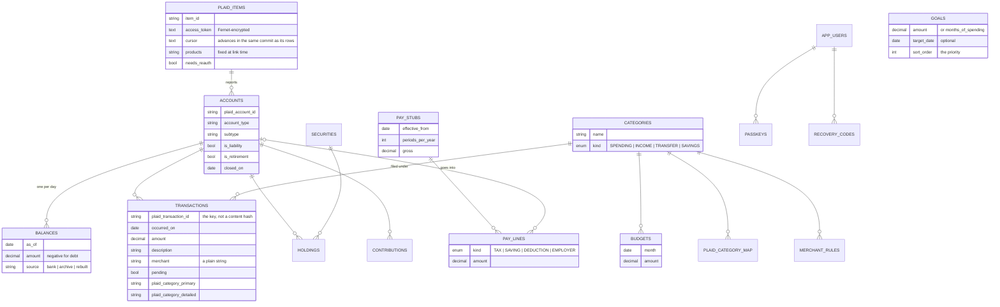

An account's **group** is derived, not stored (`Account.group`). The order
matters: retirement is checked before investment.

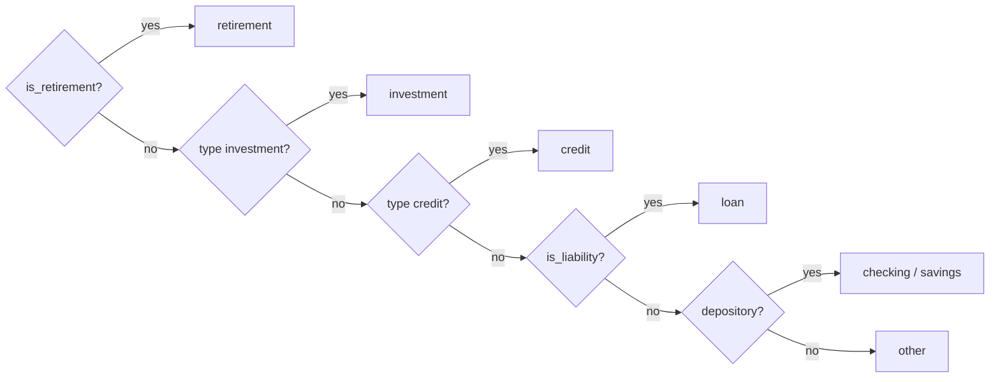

---

## 3. Refresh: getting the banks' data in

There is no review step: what the banks send is written straight to the
database. A refresh runs on its own the first time the app is opened each
day (`sync.ts`), from the header's **Refresh** button, or from
`scripts/refresh.py`.

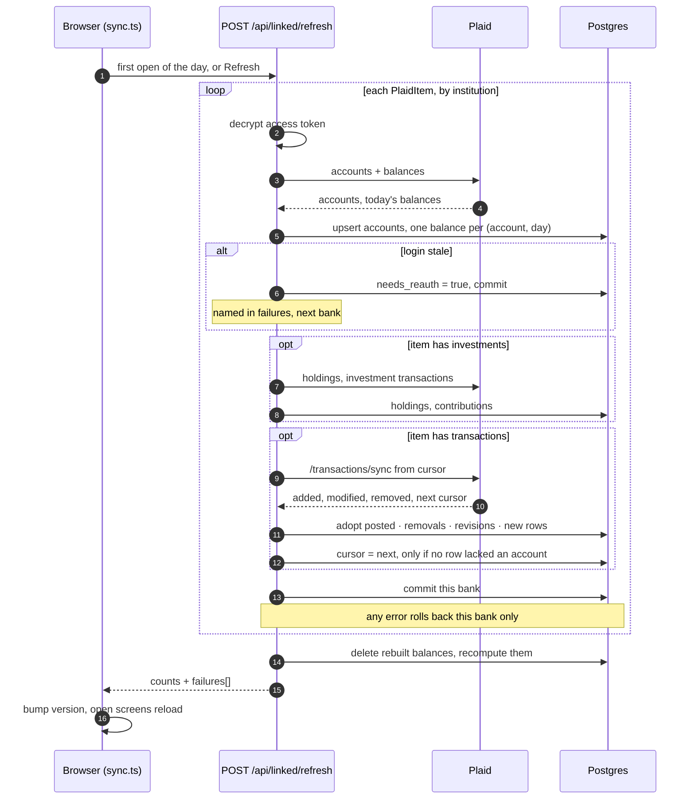

The order inside one bank's transaction sync is what keeps a charge from being
counted twice or lost:

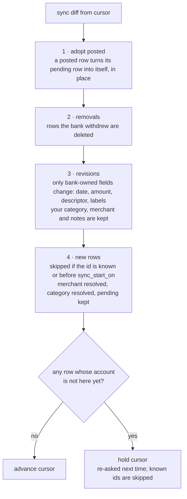

---

## 4. Filing a transaction

Every write path calls the same two functions, `merchants.resolve` and
`categorize.resolve_category`.

### Merchant

A merchant is a plain string, and it snaps to names already in use, so a
second spelling never gets in.

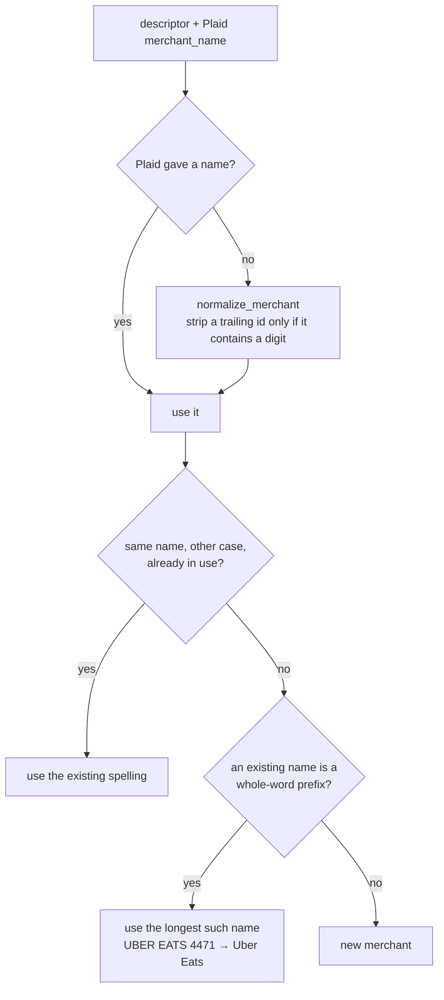

### Category

The first rule that answers wins. A row you change by hand is never
overwritten by a re-sync.

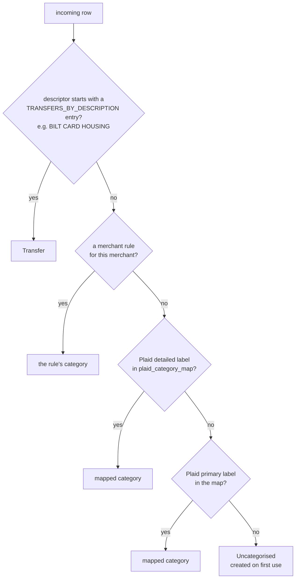

The descriptor check comes before merchant rules on purpose, so that no rule
can turn a transfer back into spending. Merchant rules are set from the list
of regular charges. **File everything uncategorised** re-runs this chain over
existing rows using the Plaid labels stored on them.

**Rent through Bilt** arrives as three rows and is counted once:

| Row | Plaid says | Filed as | By |
|---|---|---|---|
| `BILT CARD HOUSING` debit, Chase | rent | Transfer | descriptor rule |
| `Payment - Bilt Housing` credit, Bilt | rental income | Transfer | map: `INCOME_RENTAL` |
| `Bilt Housing Payment` charge, Bilt | rent | Rent | map |

---

## 5. The month

`queries.month_summary` puts every row in the month into a bucket by its
category's kind in a single pass. Everything else on the Month screen reads
from those buckets.

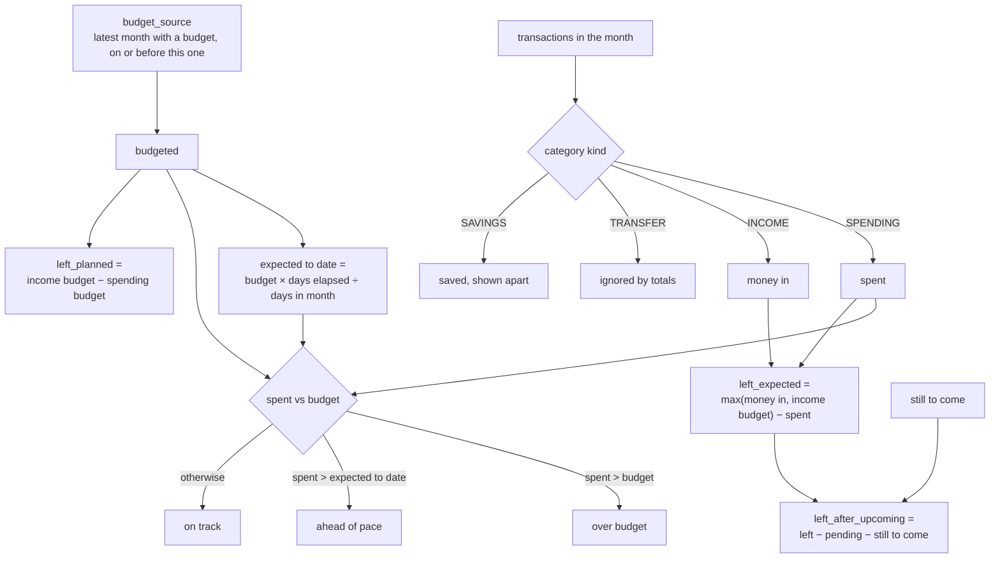

The states are computed in `Decimal` on the server and sent to the browser
as booleans.

### Regular charges and "still to come"

These are worked out from the rows each time, never stored.

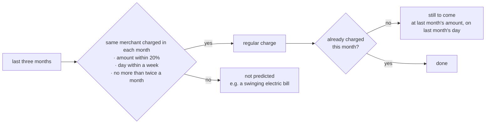

---

## 6. Budgets

A month without a budget of its own uses the latest set before it, so a
budget is set once and only touched to change something.

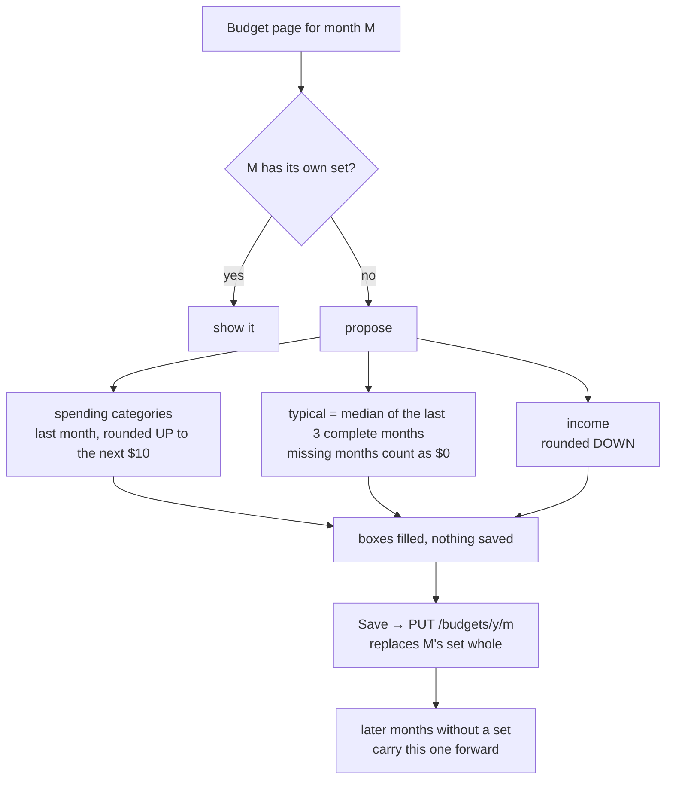

The rounding is deliberate. Rounding spending up means the proposal isn't a
budget you already broke last month. Rounding income down means the plan
doesn't count on money that might not arrive. The typical month uses the
median so one big holiday doesn't read as a habit.

---

## 7. Net worth over time

There is one balance row per account per day, and the series is a `GROUP BY`
over them. Plaid only reports today's balance, so the days in between are
rebuilt after every refresh.

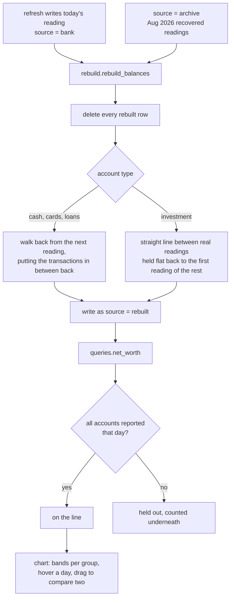

A real reading is never overwritten by a rebuilt one. The chart says how many
of the days it draws are rebuilt, and marks a rebuilt day in its tooltip.

---

## 8. Where you stand: the Overview

`overview.py` has two halves. **Standing** is today's balances by kind of
money. **Flow** is each month: earned, spent and kept. The bank only sees
take-home pay, so the pay stub (entered once and carried forward) supplies
what happens before the money lands.

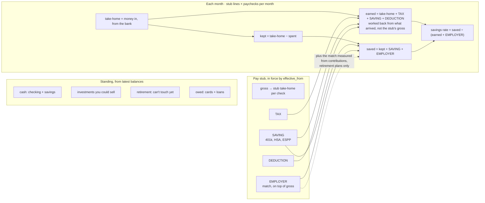

Without a stub, the savings rate is kept ÷ take-home. In a month still
running, the stub is scaled to the paychecks that have actually landed, so on
the 2nd of the month a whole month's 401(k) isn't counted before any pay has
arrived. Typical figures are taken over the last three finished months. A month counts
as complete only if every bank has history for it, give or take a 7-day
grace period.

---

## 9. Goals

All goals draw on one pot: money you could actually spend on them. The pot is
split down the goal list in order, using cash first, and then each month's
reachable saving fills whatever is still needed.

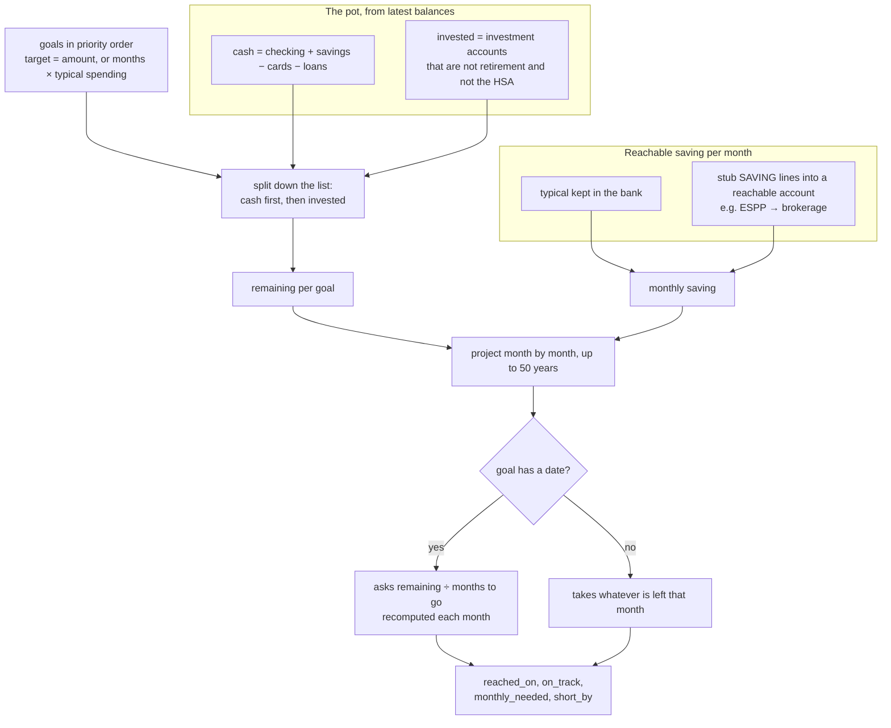

No investment growth is assumed. A 401(k) counts as saving, but it can't be
spent on a house, so it isn't in the pot.

---

## 10. Signing in

There is one user. The login guard sits on the `/api` router itself, so any
route is protected unless it's listed in `auth.PUBLIC_PATHS`.

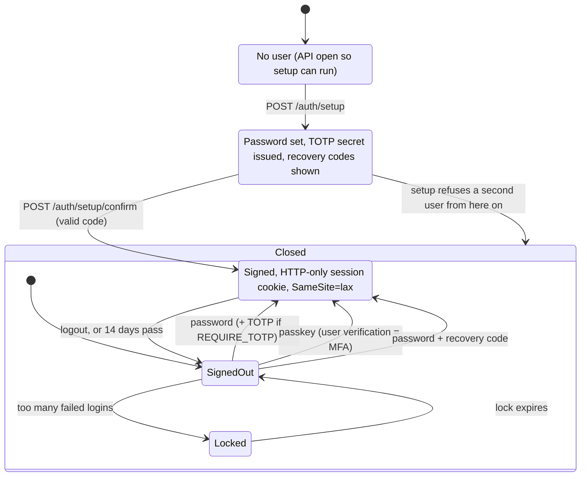

| Secret | Protects | If it changes |
|---|---|---|
| `SESSION_SECRET` | the session cookie | everyone is signed out, nothing else |
| `PLAID_TOKEN_KEY` | Plaid access tokens at rest | **every linked bank is orphaned** |
| `webauthn_rp_id` (config) | passkeys are bound to it | every passkey stops working |
| DB password | the database | update the secret and the DB together |
